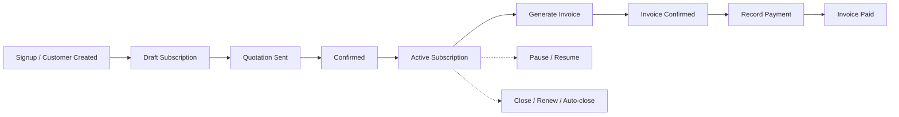

# Brightloop Software - Subscription Management System

A complete, runnable Subscription Management and Recurring Billing System built for **Brightloop Software** using **Django 5**, **SQLite**, and **Bootstrap 5 (CDN)**.

---

## 1. Overview
Brightloop Software provides subscription-based software and enterprise managed services. This system manages the complete customer lifecycle:
- Product and variant catalogs
- Flexible pricing plans with automated renewal, pause, and close policies
- Quotation templates and multi-line subscriptions
- Automated recurring billing engine with discount, tax, and idempotency guarantees
- Multi-channel payment recording and real-time status transitions
- Role-specific workflows for Administrators, Staff, and Customers
- Executive dashboard with revenue metrics and overdue invoice tracking

---

## 2. Tech Stack
- **Backend**: Python 3.13 / Django 5 (5.2)
- **Database**: SQLite (optimized with indexes on `status`, `due_date`, `customer`, and compound indexes)
- **Frontend**: Django Templates + Bootstrap 5.3 CDN + Bootstrap Icons
- **Email Backend**: Django Console Backend (logs password reset links and sent invoices directly to terminal output)

---

## 3. Quick Start & Setup

### Prerequisites
- Python 3.10+ installed

### Step-by-Step Installation

1. **Install Dependencies**:
   ```bash
   pip install -r requirements.txt
   ```

2. **Apply Database Migrations**:
   ```bash
   python manage.py migrate
   ```

3. **Seed Demo Data**:
   Populates 1 admin, 1 staff, 5 customers, 3 products with variants, 3 plans, 2 taxes, 2 discounts, and 31 subscriptions with invoices and payments (including overdue invoices):
   ```bash
   python manage.py seed
   ```

4. **Seed Bulk High-Scale Data (5,000 Subscriptions)**:
   Generates 5,000 subscriptions spread across 200 customers with mixed statuses, 4,000 invoices, and ~1,700 payments using `bulk_create`:
   ```bash
   python manage.py seed_bulk
   ```

5. **Run the Development Server**:
   ```bash
   python manage.py runserver
   ```
   Open your browser and visit: `http://127.0.0.1:8000/`

6. **Run the Recurring Billing Engine (Management Command)**:
   Finds all active subscriptions due today or earlier and generates invoices idempotently:
   ```bash
   python manage.py generate_invoices
   ```

7. **Run Automated Tests**:
   ```bash
   python manage.py test
   ```

---

## 4. Demo Credentials

| Role | Email | Password | Access Scope |
| :--- | :--- | :--- | :--- |
| **Administrator** | `admin@brightloop.com` | `Admin@1234` | Full access: dashboard, user & staff management, taxes, discounts, catalog, subscriptions, invoices |
| **Staff Member** | `staff@brightloop.com` | `Staff@1234` | Operational access: dashboard, products, plans, quotation templates, subscriptions, invoices, payments (no user mgmt, no taxes, no discounts) |
| **Customer** | `customer1@acme.com` | `Customer@1234` | Customer portal: view own subscriptions, line items, and invoices |
| **Customer** | `customer2@globex.com` | `Customer@1234` | Customer portal: view own subscriptions, line items, and invoices |

*Note: New customers can register at `/accounts/signup/` with passwords containing >8 chars, at least 1 uppercase, 1 lowercase, and 1 special character.*

---

## 5. Feature List by Role

### 🛡️ Administrator (`admin`)
- **Full Operational Oversight**: Everything accessible to staff plus exclusive administration privileges.
- **Staff User Management**: Create and review internal staff members via `/accounts/staff/`.
- **Taxes Management**: Configure tax names and percentages (e.g. Standard 8%, VAT 18%) applied automatically on invoice generation.
- **Discounts Management**: Configure fixed amount or percentage discounts, minimum purchase, minimum quantity thresholds, start/end dates, usage limits, and whole-order or product-specific applicability.
- **Executive Dashboard**: Monitor active contracts, revenue collected, total outstanding balance, and overdue receivables with filters and pagination.

### 👤 Staff Member (`staff`)
- **Management Dashboard**: Filter and inspect overdue invoices by date range, customer, and status.
- **Catalog Management**: Create and edit Products (Service, License, Support, Goods), configure Variants (e.g., Odoo Brand adds ₹560.00, Enterprise Tier, 24/7 Support).
- **Plan Management**: Configure billing cadences (Daily, Weekly, Monthly, Yearly), lifecycle policies (`auto_close`, `closable`, `pausable`, `renewable`), and validity windows.
- **Quotation Templates**: Create standard bundles with predefined line items and quantities.
- **Subscription Management**:
  - Create new subscriptions from scratch or pre-fill from quotation templates.
  - Add and delete line items during Draft and Quotation stages.
  - Execute strict lifecycle transitions with validation (`Draft` &rarr; `Quotation` &rarr; `Confirmed` &rarr; `Active` &rarr; `Paused` / `Closed` / `Renewed`).
  - Auto-close subscriptions past plan end dates when `auto_close` is enabled.
- **Billing & Invoicing**:
  - One-click invoice generation for active subscriptions.
  - Confirm draft invoices and cancel unpaid invoices.
  - Send email statements to customers (logged to console output).
  - Clean printable invoice format suitable for printing or saving as PDF.
  - Record payments across payment methods (`card`, `bank`, `upi`, `cash`) with automatic status progression to `Paid`.

### 👥 Customer (`customer`)
- **Secure Self-Registration**: Custom validation rules enforcing password strength (>8 chars, uppercase, lowercase, special character).
- **Browse Plans**: Browse active software packages and configure seat/package quantities to immediately generate a subscription quotation.
- **My Subscriptions**:
  - Filter by contract status and paginate through active and historical subscriptions.
  - Colour-coded status badges per row and direct "View" button for full contract details.
  - Subscription detail view showing lines table (product, variant, qty, unit price, tax, amount, total) and payment terms.
  - Self-service Pause, Close, and Renew actions available only when plan flags (`pausable`, `closable`, `renewable`) allow them, protected by confirmation dialogs.
- **My Invoices & Real-time Payments**:
  - Summary KPI cards: Total Outstanding, Total Paid, and Overdue Count.
  - Status badges with prominent red "Overdue" indicator for unpaid invoices past due date.
  - Filter by invoice status with pagination.
  - Interactive "Pay Now" form (Card, Bank, UPI, Cash) that records payments and automatically marks invoices `Paid` when balance reaches zero.
  - Printable invoice page (`/print/`) and payment history table.
- **Strict Security Enforcement**: Customers can only view, transition, or pay their own subscriptions and invoices (any attempt to access another customer's ID returns HTTP 404).
- **Password Reset**: Self-service forgotten password flow with console email link generation.

---

## 6. End-to-End System Flow



1. **Onboarding**: A customer signs up or is created by staff.
2. **Subscription Initiation**: Staff creates a Subscription for the customer and selects a Plan and optional Quotation Template. Line items with products, variants, quantities, and taxes are configured.
3. **Quotation & Confirmation**: Staff converts the subscription to `Quotation` and then `Confirmed` once terms are agreed upon.
4. **Activation**: Staff activates the subscription (`Active`). This schedules the `next_billing_date`.
5. **Invoice Generation**:
   - Invoices can be generated on-demand via the subscription page or periodically via `python manage.py generate_invoices`.
   - The billing service calculates subtotal, checks all active discounts (evaluating start/end dates, minimum quantity, minimum purchase, and usage limit), applies the best discount, calculates line taxes, computes grand total, and advances the subscription's `next_billing_date`.
   - The database enforces a `UniqueConstraint(fields=['subscription', 'period_start'])` guaranteeing no period is billed twice.
6. **Payment & Reconciliation**:
   - Invoices start in `Draft` and move to `Confirmed`.
   - Payments are recorded against the invoice. When payments equal or exceed the total, the invoice status automatically updates to `Paid`.
7. **Lifecycle Controls**:
   - If a plan is `pausable`, staff can pause and resume the subscription.
   - If a plan is `closable`, staff can close early.
   - If a plan has `auto_close=True` and its end date has passed, the subscription automatically transitions to `Closed`.
   - If a plan is `renewable`, closed subscriptions can be renewed back to `Active`.
